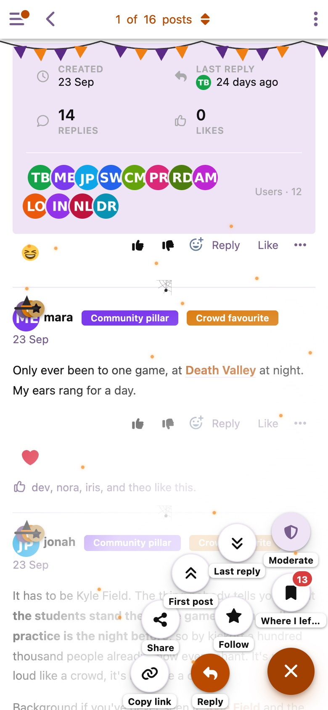
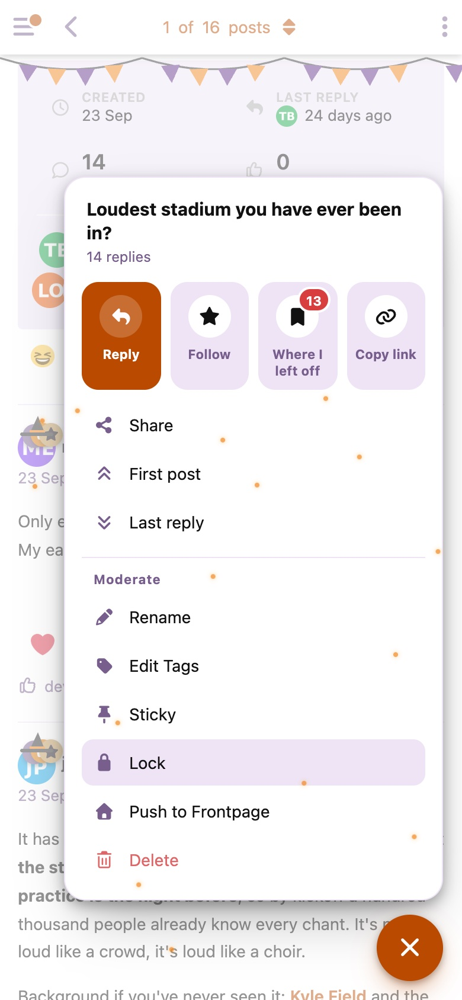

# Quickdraw

A floating action button for Flarum discussion pages. Tap it and the actions for the discussion you're reading fan out from the corner, within reach of your thumb.

- **Reply**, **Follow**, and **Where I left off** (with your unread count)
- **Copy link**, **Share** (the phone's own share sheet), **First post** and **Last reply**
- **Moderate**, for moderators and admins: flagged posts in this discussion (the count shows on the button), then every moderation control your forum has, such as rename, lock, sticky, tags and delete
- Guests get the actions that don't need an account, plus **Log in to reply**

 

Quickdraw only appears on discussion pages. It builds its menu from the discussion page's own controls, so actions added by other extensions show up too. Each action only shows when the viewer is allowed to use it.

## Settings

- **Layout:** *Fan* (round buttons spread out from the corner) or *Panel* (a card with labeled actions)
- **Show on:** phones and computers, or phones only
- **Corner:** bottom right or bottom left

The button follows your theme's primary color and dark mode. It moves up out of the way of cookie banners, the minimized composer and bottom tab bars, and hides while you're writing.

## Install

```sh
composer require ernestdefoe/quickdraw
```

## Update

```sh
composer update ernestdefoe/quickdraw
php flarum cache:clear
```

## Support

[Issues](https://github.com/ernestdefoe/quickdraw/issues) · [Support forum](https://ernestdefoe.online)

☕ If you like the things I have built, consider [buying me a coffee](https://buymeacoffee.com/ernestdefoe).

MIT licensed.
